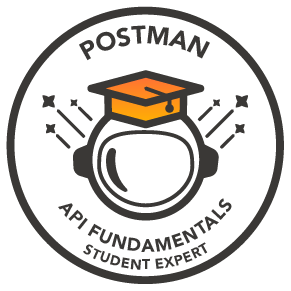
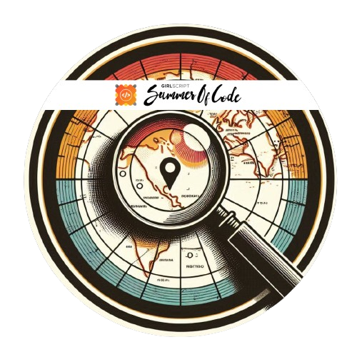
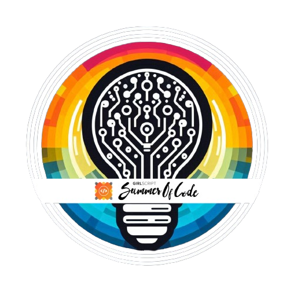
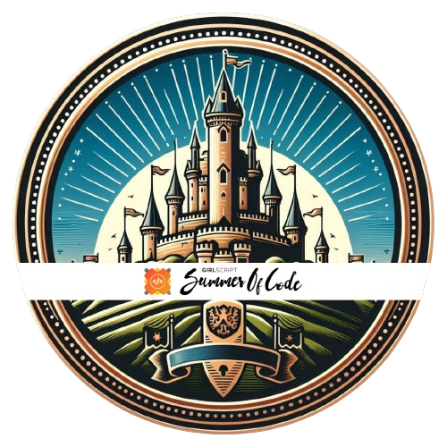

<div align="center">

<a href="https://git.io/typing-svg"></a>

<a href="https://siddheya-kulkarni-portfolio.vercel.app"></a>
<a href="https://linkedin.com/in/siddheya-kulkarni"></a>
<a href="https://twitter.com/SidKulkarni712"></a>
<a href="https://instagram.com/sid_kulkarni_712"></a>
<a href="https://buymeacoffee.com/siddheyakue"></a>

</div>

<br/>

## 👋 About Me

```ts
const siddheya = {
  role: "Full Stack Developer",
  location: "India 🇮🇳",
  currentlyContributingTo: ["Kestra", "Tabularis", "DocsGPT", "tscircuit"],
  interests: ["Developer tools", "Workflow orchestration", "AI agents", "Open source"],
  achievements: ["Rank #4 — GirlScript Summer of Code 2024"],
};
```

<br/>

## 🚀 Open Source Highlights

<div align="center">

<table>
  <tr>
    <th>Project</th>
    <th>What it is</th>
    <th>Contributions</th>
  </tr>
  <tr>
    <td>
      <a href="https://github.com/kestra-io/kestra">&nbsp;<b>Kestra</b></a><br/>
      
    </td>
    <td>Open-source workflow orchestration platform</td>
    <td align="center">
      <a href="https://github.com/kestra-io/kestra/pulls?q=is%3Apr+author%3AAsymtode712+is%3Amerged"></a>
    </td>
  </tr>
  <tr>
    <td>
      <a href="https://github.com/arc53/DocsGPT">&nbsp;<b>DocsGPT</b></a><br/>
      
    </td>
    <td>Private AI platform for agents &amp; enterprise search</td>
    <td align="center">
      <a href="https://github.com/arc53/DocsGPT/pulls?q=is%3Apr+author%3AAsymtode712+is%3Amerged"></a>
    </td>
  </tr>
  <tr>
    <td>
      <a href="https://github.com/TabularisDB/tabularis">&nbsp;<b>Tabularis</b></a><br/>
      
    </td>
    <td>Open-source desktop SQL workspace</td>
    <td align="center">
      <a href="https://github.com/TabularisDB/tabularis/pulls?q=is%3Apr+author%3AAsymtode712+is%3Amerged"></a>
    </td>
  </tr>
  <tr>
    <td>
      <a href="https://github.com/tscircuit/tscircuit">&nbsp;<b>tscircuit</b></a><br/>
      
    </td>
    <td>Build real electronics with TypeScript &amp; React</td>
    <td align="center">
      <a href="https://github.com/pulls?q=is%3Apr+author%3AAsymtode712+org%3Atscircuit+is%3Amerged"></a>
    </td>
  </tr>
  <tr>
    <td>
      <a href="https://github.com/a2aproject/a2a-java">&nbsp;<b>A2A Java SDK</b></a><br/>
      
    </td>
    <td>Official Java SDK for the Agent2Agent protocol</td>
    <td align="center">
      <a href="https://github.com/a2aproject/a2a-java/pulls?q=is%3Apr+author%3AAsymtode712+is%3Amerged"></a>
    </td>
  </tr>
  <tr>
    <td>
      <a href="https://github.com/reticlehq/reticle">&nbsp;<b>Reticle</b></a><br/>
      
    </td>
    <td>Runtime perception for AI agents on web &amp; desktop apps</td>
    <td align="center">
      <a href="https://github.com/reticlehq/reticle/pulls?q=is%3Apr+author%3AAsymtode712+is%3Amerged"></a>
    </td>
  </tr>
</table>

<sub>Also contributed to&nbsp;
<a href="https://github.com/ToolJet/ToolJet/pull/10860"></a>&nbsp;
<a href="https://github.com/ghostfolio/ghostfolio/pull/8194"></a>&nbsp;
<a href="https://github.com/formbricks/formbricks/pull/3548"></a>&nbsp;
<a href="https://github.com/useagenthq/useagent/pulls?q=is%3Apr+author%3AAsymtode712+is%3Amerged"></a>&nbsp;
<a href="https://github.com/brekkylab/backlot/pull/430"></a>&nbsp;
<a href="https://github.com/Avenx-JS/avenx-js/pulls?q=is%3Apr+author%3AAsymtode712+is%3Amerged"></a>
</sub>

</div>

<details>
<summary><b>✨ Featured merged PRs</b></summary>
<br/>

| Project | Pull Request |
|:--|:--|
| **Kestra** | [feat(core): optional pagination on `GET /logs/{executionId}`](https://github.com/kestra-io/kestra/pull/21390) |
| **Kestra** | [fix(executions): show full task ids and a comparable duration bar in the Gantt view](https://github.com/kestra-io/kestra/pull/21149) |
| **DocsGPT** | [feat(connectors): add Alpha Vantage MCP connector preset](https://github.com/arc53/DocsGPT/pull/3039) |
| **DocsGPT** | [fix(connectors): stop the MCP OAuth wait when the user cancels sign-in](https://github.com/arc53/DocsGPT/pull/3055) |
| **Tabularis** | [feat(favorites): organize saved queries in connection folders](https://github.com/TabularisDB/tabularis/pull/1181) |
| **Tabularis** | [fix(plugins): refresh connection catalogue after plugin install/remove](https://github.com/TabularisDB/tabularis/pull/1263) |
| **Tabularis** | [feat(json): expand all / collapse all controls for JSON trees](https://github.com/TabularisDB/tabularis/pull/1174) |
| **tscircuit** | [feat: `pcbStyle.silkscreenFontSize` for global silkscreen text sizing](https://github.com/tscircuit/core/pull/1597) |
| **tscircuit** | [feat: automatic label alignment for voltage probes](https://github.com/tscircuit/core/pull/1756) |
| **tscircuit** | [feat: infinite grid with fade-out in the 3D renderer](https://github.com/tscircuit/poppygl/pull/17) |
| **tscircuit** | [feat: STEP file export in download options](https://github.com/tscircuit/runframe/pull/1413) |
| **A2A Java SDK** | [feat: message creation methods with `contextId` and `taskId` support](https://github.com/a2aproject/a2a-java/pull/322) |
| **Reticle** | [feat(browser): let a project name its test-id attribute](https://github.com/reticlehq/reticle/pull/1395) |
| **ToolJet** | [docs: Timeline component documentation](https://github.com/ToolJet/ToolJet/pull/10860) |

<sub>👉 <a href="https://github.com/pulls?q=is%3Apr+author%3AAsymtode712+is%3Amerged+-user%3AAsymtode712">See all merged PRs</a></sub>

</details>

<br/>

## 🛠️ Tech Stack

<div align="center">

<br/>
<br/>


</div>

<br/>

## 📊 GitHub Stats

<div align="center">


</div>

<br/>

## 🏆 Achievements

<div align="center">


</div>

<details>
<summary><b>🥇 GSSoC'24 Badges — Rank #4</b></summary>
<br/>
<div align="center">
  <a href="https://gssoc.girlscript.tech/leaderboard">
    
    
    
    
    
    
    
    
  </a>
</div>
</details>

<details>
<summary><b>📌 Holopin Badges</b></summary>
<br/>

[](https://holopin.io/@asymtode712)

</details>

<br/>

<div align="center">

<sub>Thanks for stopping by! ⭐ If you like my work, feel free to <a href="https://buymeacoffee.com/siddheyakue">buy me a coffee</a>.</sub>

<br/><br/>


</div>


